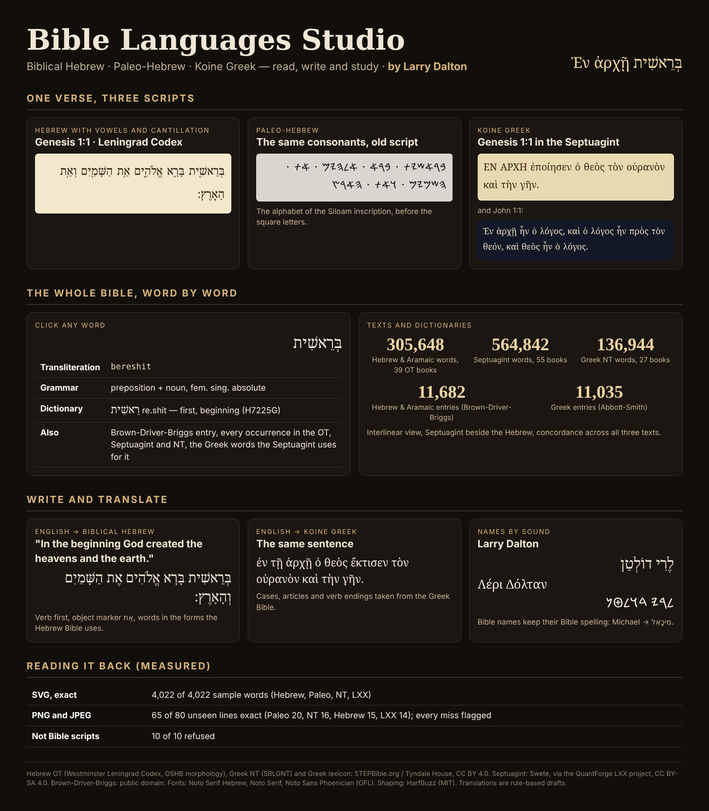
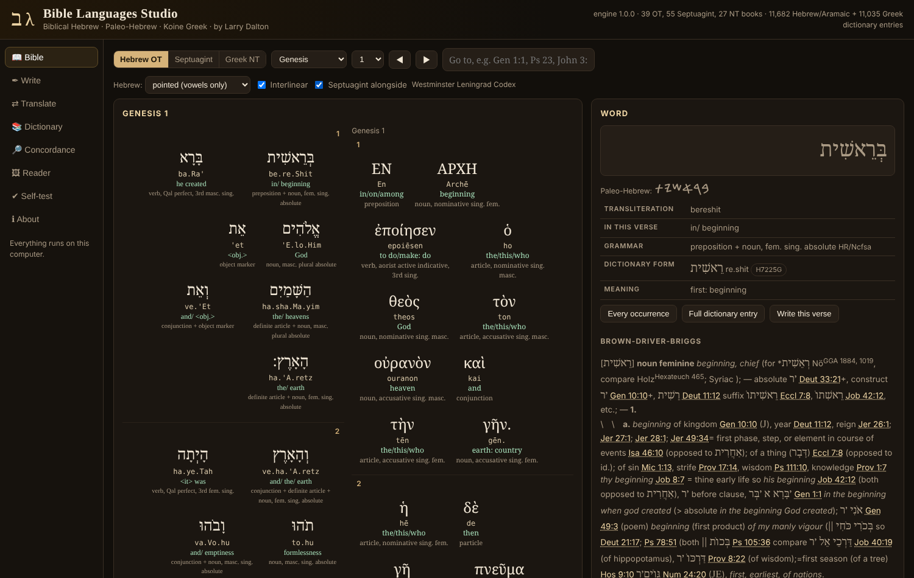

<h1 align="center">Bible Languages Studio</h1>

<b>Read, write and study Biblical Hebrew, Paleo-Hebrew and Koine Greek. By Larry Dalton.</b> 
A local Windows studio with the Hebrew Old Testament, the Greek New Testament and the Septuagint, word by word, with dictionaries, a concordance, English to Hebrew and Greek drafts, and a reader for SVG and images.

<a href="../../releases/latest"><b>Download for Windows</b></a> ·
<a href="docs/HOW-IT-WORKS.md">How it works</a> ·
<a href="docs/READER.md">Reader and test results</a> ·
<a href="NOTICE.md">Credits and licences</a>

---

## What it does

| Area | What you get |
|---|---|
| **Bible** | The Hebrew OT (Westminster Leningrad Codex, 305,648 words, 39 books) with vowels and cantillation, the Septuagint (Swete, 564,842 words, 55 books) and the Greek NT (SBLGNT, 136,944 words, 27 books). Hebrew can be shown with full pointing, vowels only, consonants only or in Paleo-Hebrew. Interlinear view, and the Septuagint beside the Hebrew. Go to any reference (`Gen 1:1`, `Ps 23`, `John 3:16`). |
| **Word study** | Click any word: transliteration, gloss, decoded grammar, dictionary form and Strong's number, the Paleo-Hebrew spelling, the full Brown-Driver-Briggs (11,682 Hebrew and Aramaic entries) or Abbott-Smith (11,035 Greek entries) entry, every occurrence, and the Greek words the Septuagint uses for a Hebrew word. |
| **Concordance** | Search by lemma, Strong's number, form or English gloss across the OT, Septuagint and NT. |
| **Write** | Hebrew (with nikkud and cantillation), Paleo-Hebrew and Greek, from Hebrew/Greek text, Beta Code, transliteration or English sound (`Larry Dalton` → לֶרִי דוֹלְטַן, Λέρι Δόλταν). Bible names keep their Bible spelling. Export SVG, PNG or JPEG in four styles. |
| **Translate** | Rule-based English → Biblical Hebrew and Koine Greek **drafts** that use the word forms the Bible itself uses: Hebrew verb-first order, אֶת, prefixes, construct chains, suffixes, nominal sentences; Greek cases, articles and attested verb endings. *In the beginning God created the heavens and the earth* → בְּרֵאשִׁית בָּרָא אֱלֹהִים אֶת הַשָּׁמַיִם וְהָאָרֶץ / ἐν τῇ ἀρχῇ ὁ θεὸς ἔκτισεν τὸν οὐρανὸν καὶ τὴν γῆν. *The LORD is my shepherd* → יְהֹוָה רֹעִי. Every draft shows a confidence and a word-by-word breakdown. |
| **Reader** | Reads the studio's SVGs exactly, and PNG/JPEG images of Hebrew, Paleo-Hebrew and Greek text. |

## Reading it back (measured)

| Test | Result |
|---|---|
| SVG read-back, random Bible words (Hebrew with cantillation, Paleo-Hebrew, NT, Septuagint) | **4,022 / 4,022** exact |
| 80 new random verses as PNG/JPEG, 0.6× to 2×, four styles (Hebrew with vowels, Paleo-Hebrew, NT, LXX) | **65 / 80 exact** (Paleo 20/20, NT 16/20, Hebrew 15/20, LXX 14/20); every miss was flagged as uncertain |
| Images that are not Bible scripts (Latin, noise, icon, hieroglyphs, cuneiform, pIqaD, Heptapod) | **10 / 10 refused** (these images were also used to set the refusal threshold) |
| Built-in self-test, in the studio page | **23 passed, 0 failed** |

Limits: cantillation is not read from images (SVG keeps it); small Greek accents and Hebrew vowels are the most common image misses; translations are drafts, not fluent translations. **Use SVG for exact results.** Details: [docs/READER.md](docs/READER.md).

## Install (Windows 10/11)

**Option 1: setup program.** Download `BibleLanguagesStudio-Setup.exe` from the [latest release](../../releases/latest) and run it.

- Installs for your Windows account only; no administrator rights needed.
- Runs at **http://localhost:8769/** and starts when you sign in (Cuneiform Studio uses 8768, Hieroglyph Studio 8767, so they can all run together).
- Puts the infographic on your Desktop and adds a Start-menu entry and an uninstaller in *Settings → Apps*.

The setup program is not code-signed, so SmartScreen may warn: choose **More info → Run anyway**.

**Option 2: ZIP.** Download `BibleLanguagesStudio-Package.zip`, extract it and double-click `Install.cmd`.

The installer checks every book file, both dictionaries, the fonts and the text shaper over HTTP, and puts your previous version back if any check fails. Everything runs on your computer; nothing is sent anywhere.

## Repository

| Folder | Contents |
|---|---|
| `src/app` | The studio (`index.html`, `engine.js`), data, fonts, HarfBuzz and licences |
| `src/server.ps1` | The small local web server (Windows PowerShell 5.1) |
| `installer` | `Install.ps1`, `Uninstall.ps1`, `bible.nsi` (NSIS setup), `Install.cmd`, update script |
| `tools` | `build_data.py` and `build_fonts.py` (build the data from the sources), infographic generator |
| `test` | Round-trip, image and refusal tests: see [test/README.md](test/README.md) |

Credits and licences: [NOTICE.md](NOTICE.md). Septuagint data is CC BY-SA 4.0; STEPBible data is CC BY 4.0.
